# 🔐 Практична робота №5 — Безпечний віддалений доступ до SDR-комплексу

**SSH Port Forwarding · WireGuard VPN · UFW / nftables · Ed25519**


## 🎯 Мета

Захистити доступ до веб-панелі SDR-комплексу (порт `8080`), що знаходиться за NAT:

- авторизація лише за ключами **Ed25519**, без паролів і без root;
- доступ до панелі через **SSH Local Port Forwarding** (`8080 → localhost:8888`);
- альтернативний L3-канал через **WireGuard** (`wg0`, мережа `10.8.0.0/24`);
- фаєрвол: порт `8080` відкритий **лише** на `127.0.0.1` та всередині тунелю WireGuard.

## 🧪 Стенд

Замість Raspberry Pi використано **Debian 13 у WSL2**, клієнт — хост **Windows 11**.

```
 ┌──────────── Windows (пункт моніторингу) ────────────┐
 │  Браузер → http://localhost:8888                    │
 │  WireGuard client "sdr"  10.8.0.2                   │
 └──────────────┬───────────────────────┬──────────────┘
                │ SSH -L 8888→8080      │ UDP 51820 (WireGuard)
 ┌──────────────▼───────────────────────▼──────────────┐
 │  WSL2 Debian = «SDR-борт»   172.21.120.120          │
 │  sshd :22 (ключі Ed25519)    wg0  10.8.0.1          │
 │  SDR-панель :8080            UFW: 8080 лише lo/wg0  │
 └─────────────────────────────────────────────────────┘
```

| Компонент | Значення |
|---|---|
| SDR-борт (сервер) | WSL2 Debian, `172.21.120.120` |
| SDR-панель | `0.0.0.0:8080` (+ тестова сторінка на `8080`) |
| SSH-тунель | `localhost:8888 → 127.0.0.1:8080` |
| WireGuard | сервер `10.8.0.1/24 :51820` ↔ клієнт `10.8.0.2/32` |

## 📁 Структура

```
.
├── README.md
├── configs/
│   ├── sdr-security.conf     # /etc/ssh/sshd_config.d/  (артефакт 1)
│   ├── wg0.conf              # /etc/wireguard/          (артефакт 2, ключ приховано)
│   ├── wg-client-sdr.conf    # конфіг клієнта Windows (ключ приховано)
│   ├── ssh_config            # ~/.ssh/config для автопідключення
│   └── ufw-rules.sh          # правила фаєрвола         (артефакт 3)
└── screenshots/
```

---

## 1. Підготовка WSL

```powershell
wsl --update
wsl --shutdown
```
```bash
sudo apt update
sudo apt install -y openssh-server ufw wireguard wireguard-tools python3 curl
sudo ip link add wgtest type wireguard && sudo ip link del wgtest && echo OK
```

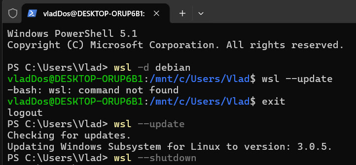
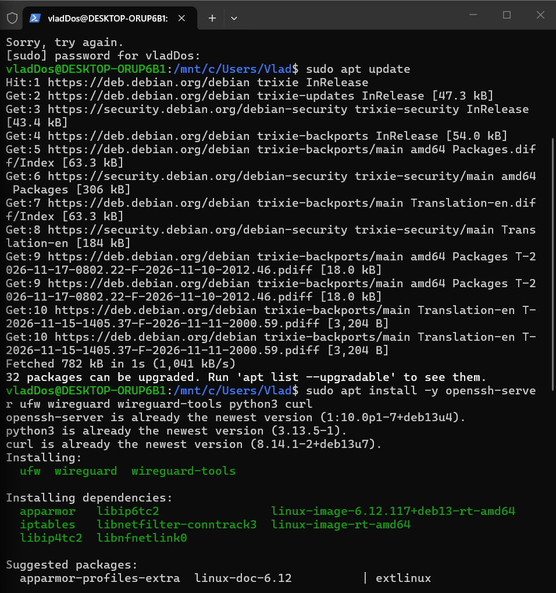
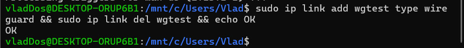
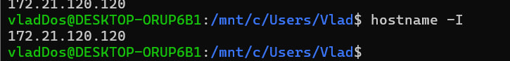

## 2. Ключі SSH Ed25519

```bash
sudo systemctl enable --now ssh
ssh-keygen -t ed25519 -C "sdr-client"
ssh-copy-id -i ~/.ssh/id_ed25519.pub vladDos@localhost
ssh -o PreferredAuthentications=publickey -o PasswordAuthentication=no vladDos@localhost "echo KEY_OK"
```

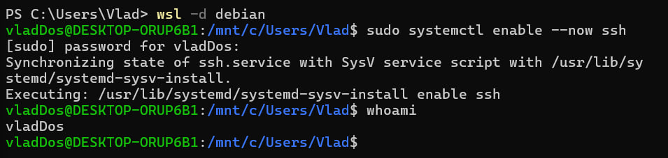
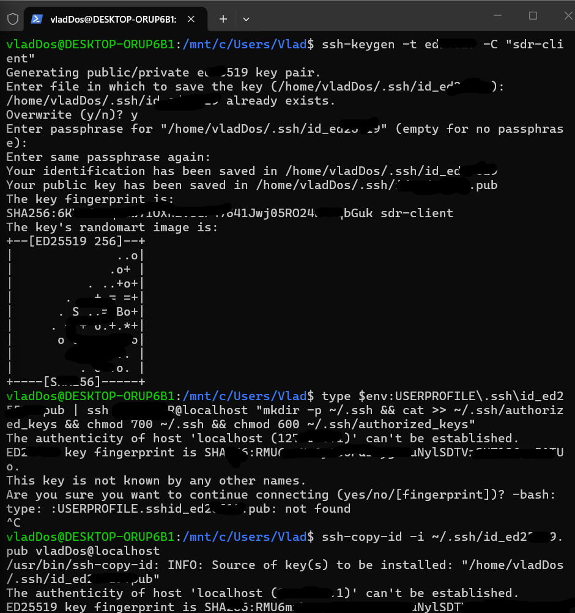
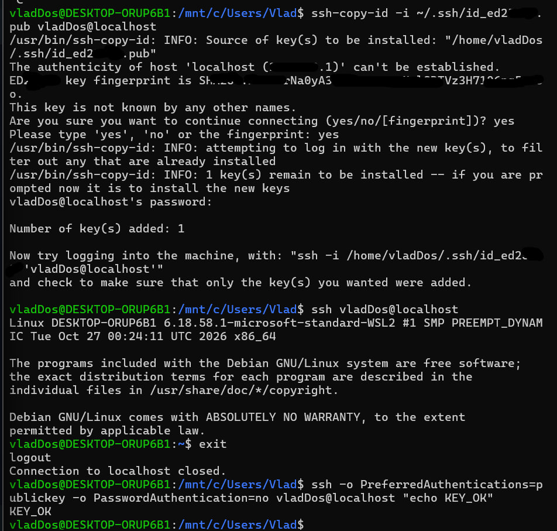

## 3. Захист SSH-сервера

Файл [`configs/sdr-security.conf`](configs/sdr-security.conf):

```ini
PasswordAuthentication no
KbdInteractiveAuthentication no
PermitRootLogin no
PubkeyAuthentication yes
PubkeyAcceptedAlgorithms ssh-ed25519
AllowTcpForwarding local
X11Forwarding no
MaxAuthTries 3
```
```bash
sudo sshd -t && sudo systemctl restart ssh
sudo sshd -T | grep -E "passwordauth|permitroot"
ssh -o PubkeyAuthentication=no vladDos@localhost   # → Permission denied (publickey)
```

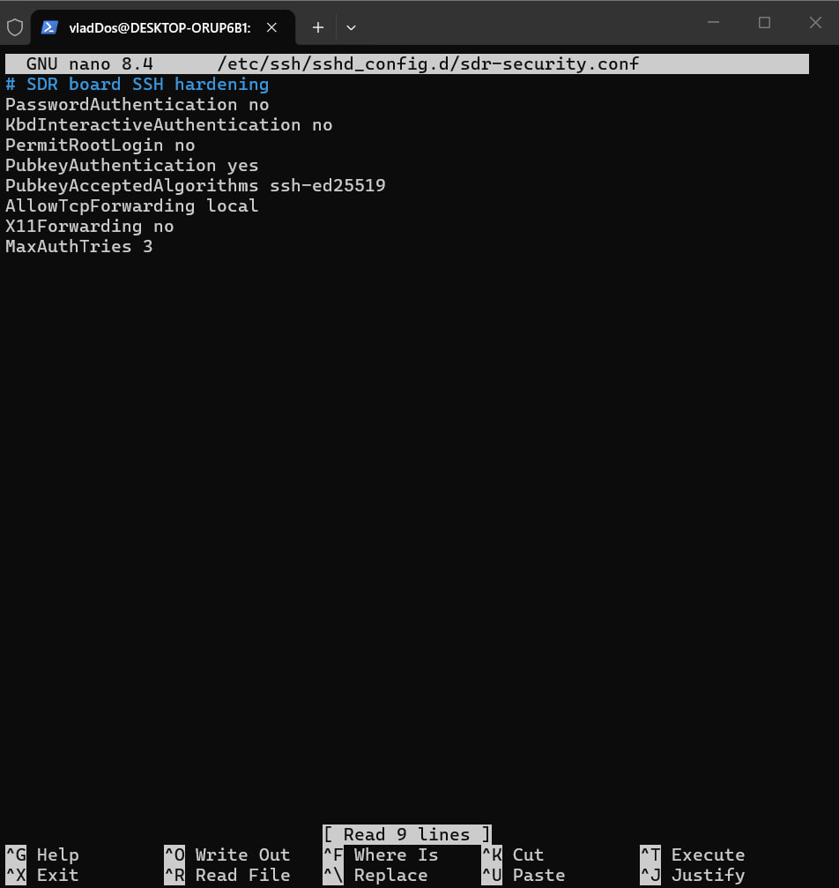
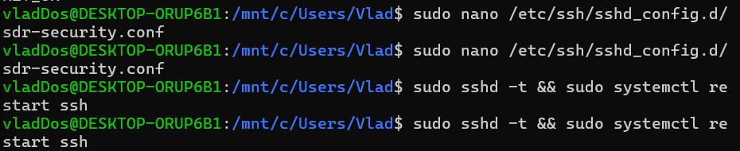
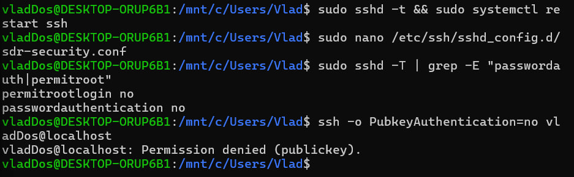

✅ Вхід за паролем і під root заборонено — пароль навіть не запитується.

## 4. SSH Local Port Forwarding

```bash
ssh -L 8888:127.0.0.1:8080 vladDos@localhost -N
# або з ~/.ssh/config:
ssh -N sdr
```

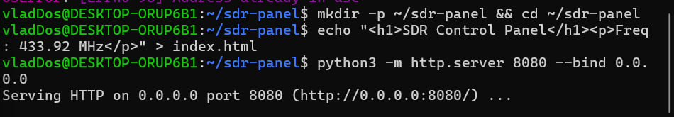
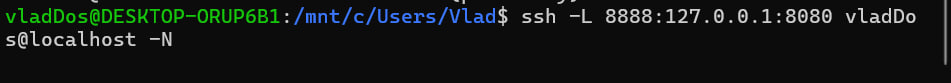
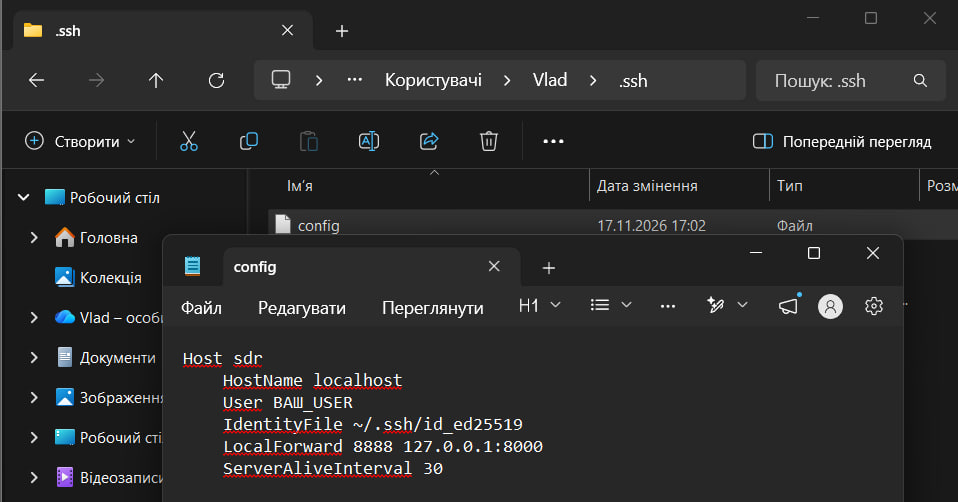

**Результат — панель відкривається через SSH-тунель на `http://localhost:8888`:**

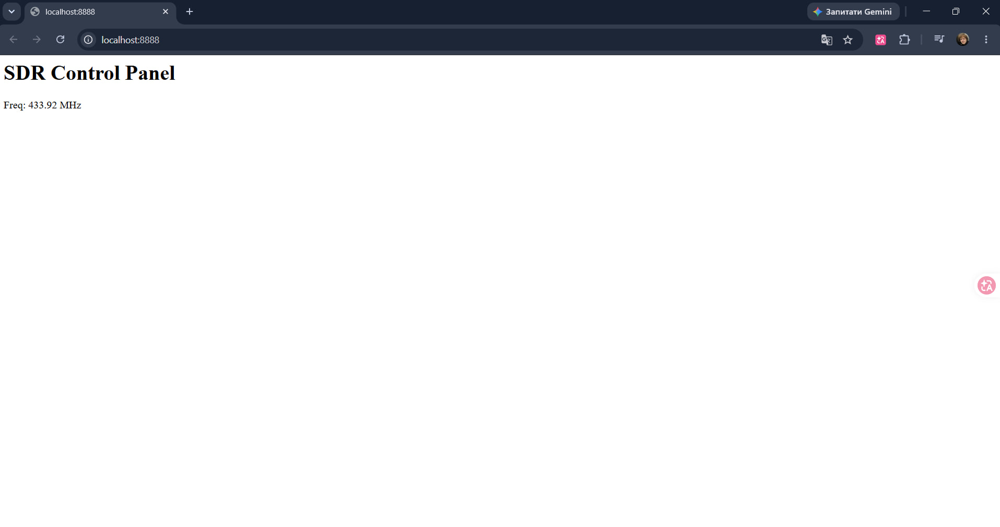

## 5. WireGuard VPN

```bash
wg genkey | sudo tee /etc/wireguard/server.key | wg pubkey | sudo tee /etc/wireguard/server.pub
sudo chmod 600 /etc/wireguard/server.key
sudo nano /etc/wireguard/wg0.conf
sudo systemctl enable --now wg-quick@wg0
sudo wg show
```

Файли: [`configs/wg0.conf`](configs/wg0.conf), [`configs/wg-client-sdr.conf`](configs/wg-client-sdr.conf)

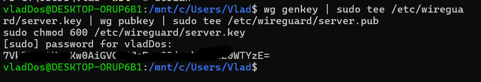
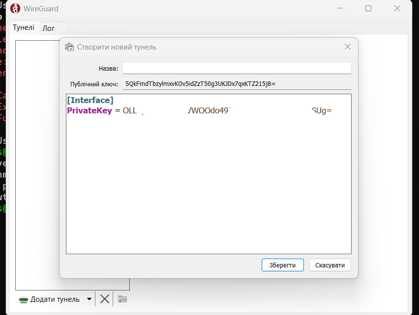
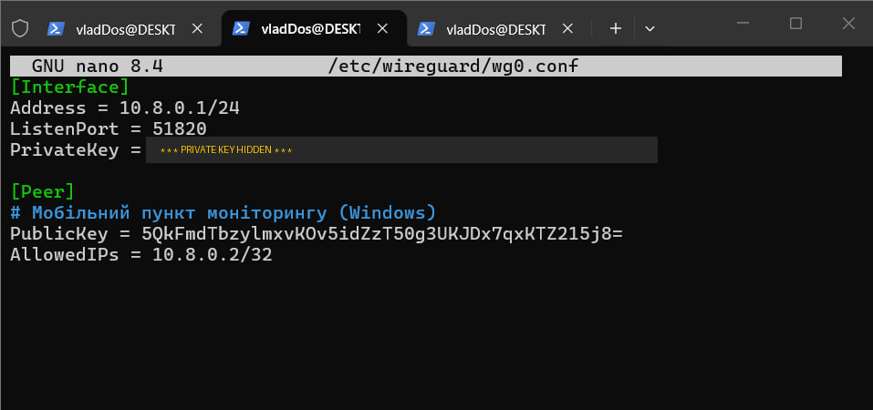
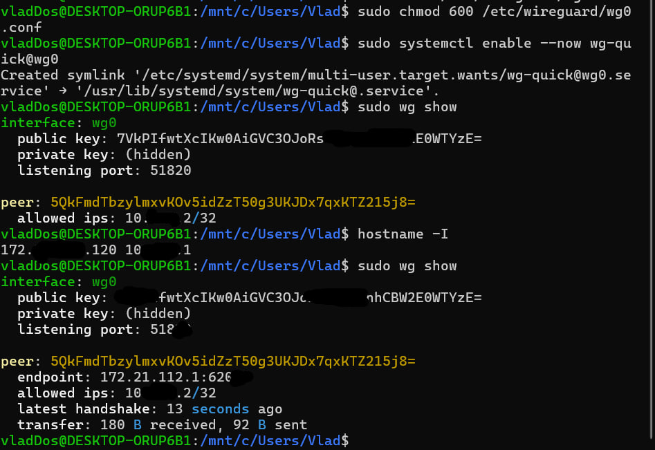
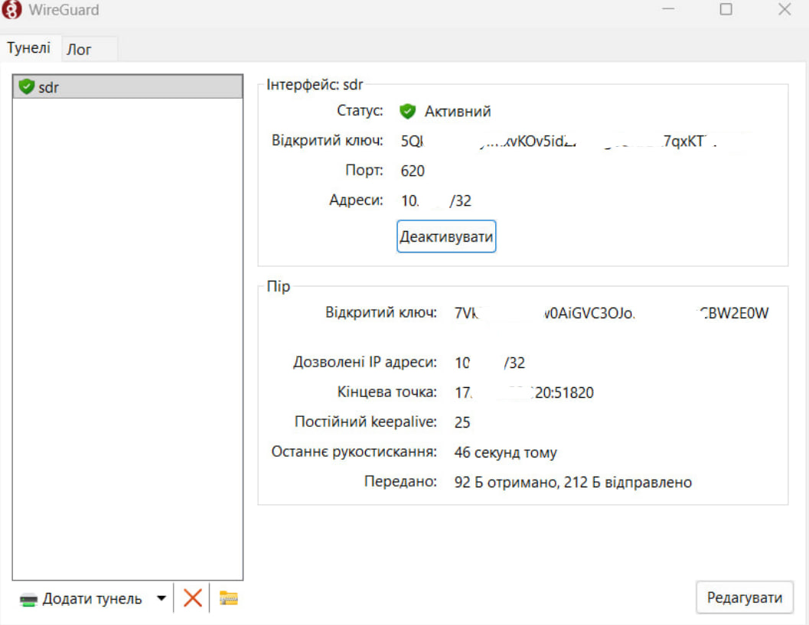

Перевірка зв'язності через тунель з Windows:

```powershell
ping 10.8.0.1
```

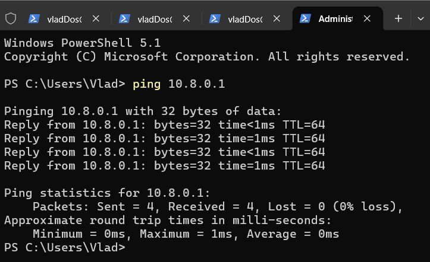

✅ `latest handshake` є з обох боків, ping 0% loss, тобто тунель встановлено.

## 6. Фаєрвол UFW

[`configs/ufw-rules.sh`](configs/ufw-rules.sh)

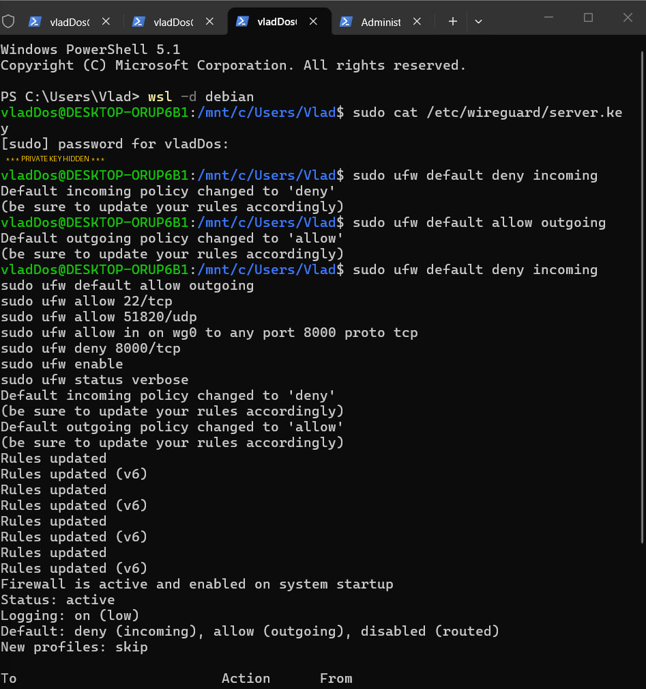
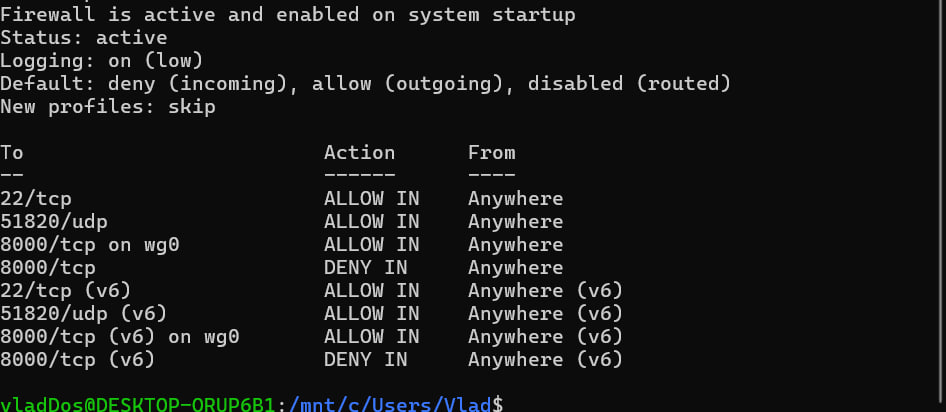

```text
$ sudo ufw status verbose
Status: active
Logging: on (low)
Default: deny (incoming), allow (outgoing), disabled (routed)

To                         Action      From
--                         ------      ----
22/tcp                     ALLOW IN    Anywhere
51820/udp                  ALLOW IN    Anywhere
8000/tcp on wg0            ALLOW IN    Anywhere
8000/tcp                   DENY IN     Anywhere
```

### Перевірка з Windows

| Запит | Результат |
|---|---|
| `curl http://172.21.120.120:8080` (напряму) | ⛔ timeout — заблоковано |
| `curl http://10.8.0.1:8080` (через WireGuard) | ✅ HTML SDR Spectrum Monitor |
| `curl http://10.8.0.1:8080` (через WireGuard, порт не дозволений) | ⛔ timeout — default deny |
| `http://localhost:8888` (через SSH) | ✅ панель відкривається |

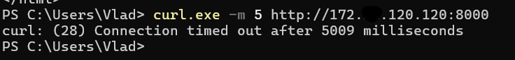
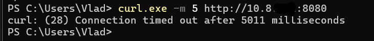

> ℹ️ Особливість WSL2: запит з Windows на `localhost:8080` йде через вбудований relay WSL (loopback),
> тому блокування демонструється саме через IP-адресу інтерфейсу `eth0`.

## ✅ Висновок

- SSH-доступ лише за ключем Ed25519, паролі та root заборонені.
- Веб-панель доступна через зашифрований SSH-тунель без відкриття порту назовні.
- WireGuard створює окремий P2P-канал `10.8.0.0/24` між пунктом моніторингу та бортом (ping 0% loss, handshake підтверджено).
- UFW пропускає порт `8080` лише з loopback і `wg0`, прямі звернення блокуються.

---
